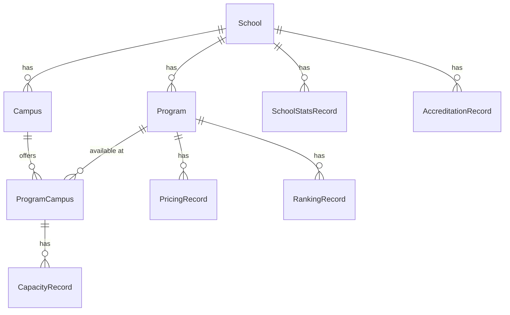

# Refactorisation : Programme unique par École (pas par Campus)

> **📁 Document historique — ne pas exécuter.** Consigne donnée à un agent le 8 juillet 2026,
> conservée pour la trace des décisions. Le code a évolué depuis ; la référence
> actuelle est [`docs/architecture/architecture.md`](../architecture/architecture.md)
> (revue le 28 septembre 2026).
>
> ⛔ **Ce plan autorisait `prisma migrate reset` sur une base quasi vide. C'est
> aujourd'hui INTERDIT** : la base Neon porte des données validées (écoles,
> programmes, 26 lignes-années). Le refactor a finalement été appliqué par une
> migration écrite à la main, qui préserve les données
> (`20260901120000_program_campus_refactor`, voir `bdd.md` §4). Ne jamais lancer
> `migrate reset`, `migrate dev` ni `db push` contre cette base.

> **Décisions confirmées par l'utilisateur :**
> - ✅ Pricing identique quel que soit le campus → `PricingRecord` reste sur `Program`
> - ✅ Capacity varie par campus → `CapacityRecord` va sur `ProgramCampus`
> - ✅ BDD drop autorisé → `prisma migrate reset` (7 écoles, 135 programmes, 3 pricing, quasi-vide)
> - ✅ Affichage liste plate de programmes (sans accordéons par campus)

---

## État actuel de la BDD (avant reset)

| Table | Count | Note |
|---|---|---|
| School | 7 | EDHEC, EMLV, ESSEC, EM Lyon, EM Normandie, HEC, SKEMA |
| Campus | 39 | SKEMA en a 15 à elle seule |
| Program | **135** | Dont **18 groupes de doublons** (ex: PGE EM Normandie × 6 campus) |
| PricingRecord | 3 | Quasi-vide, drop OK |
| RankingRecord | 3 | Quasi-vide, drop OK |
| CapacityRecord | 1 | Quasi-vide, drop OK |
| Users | 3 | ⚠️ À recréer via seed après reset |

**Après refactorisation, les 135 programmes seront réduits à ~60-70 programmes uniques** + les `ProgramCampus` pour les associations.

---

## Nouvelle Architecture

### Chaîne Relationnelle

```
School (1) ──► (N) Campus
School (1) ──► (N) Program (1) ──► (N) PricingRecord
                                  ──► (N) RankingRecord

Program (N) ◄──► (N) Campus  (via ProgramCampus)

ProgramCampus (1) ──► (N) CapacityRecord

School (1) ──► (N) SchoolStatsRecord
School (1) ──► (N) AccreditationRecord
```

### Schéma visuel



---

## Proposed Changes

### Phase 1 — Schéma BDD (Prisma)

#### [MODIFY] [schema.prisma](file:///c:/Users/aparede/Desktop/dev/appVC/prisma/schema.prisma)

**Changements sur `Program` :**
- Supprimer `campusId` → Ajouter `schoolId`
- Supprimer relation `campus Campus` → Ajouter relation `school School`
- Ajouter relation `campuses ProgramCampus[]`
- Contrainte : `@@unique([campusId, name])` → `@@unique([schoolId, name])`

**Nouveau modèle `ProgramCampus` :**
```prisma
model ProgramCampus {
  id        String   @id @default(uuid())
  programId String
  campusId  String
  
  program         Program          @relation(fields: [programId], references: [id], onDelete: Cascade)
  campus          Campus           @relation(fields: [campusId], references: [id], onDelete: Cascade)
  capacityRecords CapacityRecord[]
  
  @@unique([programId, campusId])
}
```

**Changements sur `Campus` :**
- Relation `programs Program[]` → `programCampuses ProgramCampus[]`

**Changements sur `School` :**
- Ajouter relation `programs Program[]`

**Changements sur `CapacityRecord` :**
- `programId` → `programCampusId`
- Unicité : `[programId, academic_year]` → `[programCampusId, academic_year]`

**Changements sur `ContributionInbox` :**
- Ajouter champ optionnel `programCampusId String?` (pour les tickets Capacity)

**Inchangés :** `PricingRecord`, `RankingRecord`, `SchoolStatsRecord`, `AccreditationRecord`, `User`

#### Migration

```bash
# Reset complet de la BDD (drop + recreate + seed)
npx prisma migrate reset --force
# Ou si le reset pose problème avec l'historique :
npx prisma migrate dev --name refactor_program_school_level --create-only
# Puis ajuster manuellement si nécessaire et appliquer
```

#### [MODIFY] [seed.ts](file:///c:/Users/aparede/Desktop/dev/appVC/prisma/seed.ts)
- Recréer les 3 users (admin + modérateurs)
- Les données école/campus/programmes seront re-découvertes par le pipeline Phase 1

---

### Phase 2 — Pipeline Python (Backend FastAPI)

#### [MODIFY] [phase1_research.py](file:///c:/Users/aparede/Desktop/dev/appVC/backend/pipeline/phase1_research.py)
- Le format du JSON de sortie Tavily ne change **pas** — on découvre toujours `campus[].programs[]`
- La Phase 1 produit toujours un ticket `Program_Discovery` dans l'Inbox
- **C'est la validation Admin (Phase 1 côté Next.js) qui gère la nouvelle insertion**
- ❌ Aucun changement nécessaire dans ce fichier

#### [MODIFY] [phase2_research.py](file:///c:/Users/aparede/Desktop/dev/appVC/backend/pipeline/phase2_research.py)
- **Requête programmes :** `JOIN Campus ON campusId` → `WHERE schoolId = X` direct
- **Pricing/Ranking :** Boucle sur `Program` unique (plus sur `Program × Campus`)
  - Prompt Pricing : retirer `campus_name` 
  - Prompt Ranking : inchangé
- **Capacity :** Nouvelle requête qui boucle sur `ProgramCampus JOIN Program JOIN Campus`
  - Prompt Capacity : garder `campus_name`
- **INSERT Inbox Capacity :** utiliser `programCampusId` au lieu de `programId`
- **Constantes :** `PROGRAM_LEVEL_CATEGORIES` → Capacity séparé en `PROGRAM_CAMPUS_LEVEL_CATEGORIES`

#### [MODIFY] [research_prompts.py](file:///c:/Users/aparede/Desktop/dev/appVC/backend/ai/research_prompts.py)
- `build_pricing_research_input(school_name, campus_name, program_name, ...)` → retirer `campus_name`
- `build_capacity_research_input(...)` → inchangé (garde `campus_name`)

#### [MODIFY] [diff.py](file:///c:/Users/aparede/Desktop/dev/appVC/backend/pipeline/diff.py)
- Adapter la requête Capacity si elle fait référence à `programId` → `programCampusId`

#### [MODIFY] [crowdsourcing/processor.py](file:///c:/Users/aparede/Desktop/dev/appVC/backend/crowdsourcing/processor.py)
- Pour la catégorie Capacity : résoudre `programCampusId` depuis `(programId, campusId)` du ticket
- Pour Pricing/Ranking : inchangé (utilise `programId`)

#### [MODIFY] [research_schemas.py](file:///c:/Users/aparede/Desktop/dev/appVC/backend/ai/research_schemas.py)
- Vérifier que les schemas sont compatibles (probablement aucun changement)

---

### Phase 3 — API Routes Next.js

#### [MODIFY] [validate/route.ts](file:///c:/Users/aparede/Desktop/dev/appVC/app/api/admin/inbox/%5Bid%5D/validate/route.ts)

**`validateProgramDiscovery` — Refonte majeure :**
1. Upsert `Campus` (inchangé)
2. Pour chaque programme dans chaque campus découvert :
   - Upsert `Program` avec `schoolId` + `@@unique([schoolId, name])` (déduplique automatiquement)
   - Upsert `ProgramCampus` avec `@@unique([programId, campusId])` (crée l'association)
3. Si un programme existe déjà (même nom, même école) → l'upsert fait un update (pas de doublon)
4. Le même programme découvert sur 5 campus crée 1 Program + 5 ProgramCampus

**`validateCapacity` :**
- Utiliser `programCampusId` (depuis le ticket ou résolu depuis `programId` + `campusId`)
- Upsert `[programCampusId, academic_year]`

**`validatePricing` et `validateRanking` :** — Inchangés

#### [MODIFY] [contribute/route.ts](file:///c:/Users/aparede/Desktop/dev/appVC/app/api/contribute/route.ts)
- Pour Capacity : résoudre `programCampusId` à partir de `(programId, campusId)` envoyés
- Pour Pricing/Ranking/SchoolStats/Accreditation : inchangé

#### [MODIFY] API v1 — Programmes

**[route.ts](file:///c:/Users/aparede/Desktop/dev/appVC/app/api/v1/programs/route.ts) (`GET /api/v1/programs`):**
- Requête : `campus.school` → `school` (Program lié directement à School)
- Include `campuses` via ProgramCampus pour afficher les campus disponibles
- Résultat : 1 résultat par programme unique (plus de doublons)

**`GET /api/v1/programs/[id]` :**
- Include `campuses` (ProgramCampus → Campus) pour lister les campus
- Include `capacityRecords` via ProgramCampus

**`GET /api/v1/programs/[id]/capacity` :**
- Requête via `ProgramCampus.capacityRecords` avec info campus

**`GET /api/v1/schools/[id]/programs` :**
- Retirer le filtre `?campus_id=` (les programmes sont au niveau école)
- Ou le garder comme filtre optionnel via ProgramCampus

#### [MODIFY] API v1 — Campus
**`GET /api/v1/campuses/[id]` :**
- Adapter pour passer par `ProgramCampus` au lieu de `Program` direct

#### [MODIFY] API v1 — Schools
**`GET /api/v1/schools/[id]/campuses` :**
- Inclure les programmes via ProgramCampus

---

### Phase 4 — Frontend React

#### [MODIFY] [SchoolDetailClient.tsx](file:///c:/Users/aparede/Desktop/dev/appVC/app/schools/%5Bid%5D/SchoolDetailClient.tsx)

**Avant (accordéons par campus) :**
```
📚 Programmes (15)
  ▼ Campus Le Havre (3 programmes)
    └── PGE en 5 ans | Bachelor Management | MSc Two-year
  ▼ Campus Paris (3 programmes)
    └── PGE en 5 ans | Bachelor Management | MSc Two-year
  ▼ Campus Caen (3 programmes)
    └── PGE en 5 ans | Bachelor Management | MSc Two-year
  ...5 autres accordéons
```

**Après (liste plate) :**
```
📚 Programmes (5)
  ┌── PGE en 5 ans              📍 Le Havre, Paris, Caen, Dublin, Oxford, Dubaï
  ├── Bachelor Management        📍 Le Havre, Paris, Caen
  ├── MSc Two-year               📍 Le Havre, Paris, Caen
  ├── IBBA                       📍 Paris, Dublin, Oxford, Dubaï
  └── DBA                        📍 Paris, Oxford
```

**Changements :**
- Supprimer la logique d'accordéons campus (`openCampuses` state)
- Interface `Program` : ajouter `campuses: { campus: { name, city } }[]` (via ProgramCampus)
- Chaque carte programme affiche les campus en badges
- Filtres (type, niveau) restent identiques

#### [MODIFY] [page.tsx (school detail)](file:///c:/Users/aparede/Desktop/dev/appVC/app/schools/%5Bid%5D/page.tsx)
- Requête Prisma : `school.programs` (direct) au lieu de `campuses.programs`
- Include : `programs { campuses { campus }, pricingRecords }`

#### [MODIFY] [contribute/page.tsx](file:///c:/Users/aparede/Desktop/dev/appVC/app/contribute/page.tsx)
- **Flux simplifié :**
  1. Sélection École → charge les programmes de l'école (direct, plus besoin de campus)
  2. Sélection Programme (optionnel)
  3. Sélection Campus → affiché **seulement si catégorie Capacity cochée** et programme sélectionné
  4. Le dropdown Campus filtre les campus du programme sélectionné (via ProgramCampus)

#### Page détail programme (`/schools/[id]/programs/[pid]`)
- Section "📍 Campus disponibles" avec les places par campus/année
- Pricing et Ranking affichés une seule fois (pas par campus)

---

### Phase 5 — Documentation

#### [MODIFY] [architecture.md](file:///c:/Users/aparede/Desktop/dev/appVC/docs/architecture/architecture.md)
- Mettre à jour le schéma relationnel (§3.1, §3.2)
- Mettre à jour la table ContributionInbox (§3.4 — ajout programCampusId)
- Mettre à jour la description du pipeline Phase 2 (§5.3)
- Mettre à jour les décisions architecturales (§11)

#### [MODIFY] [bdd.md](file:///c:/Users/aparede/Desktop/dev/appVC/docs/architecture/bdd.md)
- Nouveau schema Prisma complet avec ProgramCampus
- Mettre à jour la chaîne relationnelle
- Mettre à jour les directives IA (§4)

#### [MODIFY] [API-rest.md](file:///c:/Users/aparede/Desktop/dev/appVC/docs/architecture/API-rest.md)
- Adapter les descriptions des endpoints programmes et campus
- Documenter le nouveau format de réponse (programmes avec liste de campus)

---

## Verification Plan

### Automated Tests
```bash
# 1. Valider le nouveau schema
npx prisma validate

# 2. Générer le client
npx prisma generate

# 3. Reset complet BDD + migration + seed
npx prisma migrate reset --force

# 4. Build Next.js (vérifie que tout compile)
npm run build

# 5. Tests backend Python
cd backend && python -m pytest test/ -v
```

### Manual Verification
- Re-scanner une école via le pipeline Phase 1 (ex: EM Normandie)
- Valider le ticket Program_Discovery dans l'admin → vérifier qu'il crée 1 Program + N ProgramCampus
- Vérifier la fiche école : programmes en liste plate avec badges campus
- Vérifier l'API `GET /api/v1/programs?search=PGE` : 1 résultat par école
- Tester la page Contribute avec le nouveau flux simplifié

---

## Résumé de l'impact

| Métrique | Avant | Après |
|---|---|---|
| Programmes BDD (EM Normandie) | **~18** (dupliqués) | **~5** + ProgramCampus |
| Programmes BDD (SKEMA) | **~45** (15 campus × 3 prog) | **~15** + ProgramCampus |
| Crédits Tavily Phase 2 / école | N × (Pricing + Ranking + Capacity) | N × (Pricing + Ranking) + M × Capacity |
| Résultats recherche "PGE" | 5+ doublons | 1 par école |
| Accordéons sur fiche école | N campus (1 prog chacun) | 0 (liste plate) |
| UX Crowdsourcing | École→Campus→Programme | École→Programme (→Campus si Capacity) |
